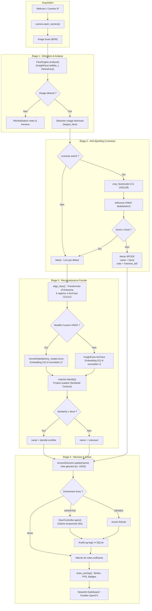

# Rapport Technique et Architectural — Face Access Control (Version Finale)

**Projet :** Contrôle d'accès biométrique facial en temps réel avec détection de vivacité (anti-usurpation) et reconnaissance faciale personnalisée.  
**Emplacement du projet unifié :** `/Users/mohamedzahar/Documents/M2/projets/Deep_learning/version_final/`  
**Date :** Novembre 2026  

---

## 1. Contexte et Objectifs de la Consolidation

Le projet initial était fractionné en trois dépôts distincts :
1. `face-access-control/` : Application principale Streamlit MVP basée sur InsightFace (`buffalo_s`), intégrant la capture webcam, la gestion de la galerie, la décision par vote glissant, la commande simulée de porte et le journal SQLite d'audit.
2. `phase2-liveness-patch/` : Patch expérimental ajoutant un modèle passif anti-usurpation (Anti-Spoofing / Liveness) basé sur MobileNetV3 pour rejeter les attaques par photo papier ou écran.
3. `custom-recognizer-overlay/` : Patch expérimental permettant de remplacer le module d'extraction d'embeddings standard par un modèle de reconnaissance ArcFace personnalisé exporté en ONNX, avec alignement facial rigide Umeyama et protection de la galerie contre les mélanges de modèles hétérogènes.

### Inconvénients de la fragmentation initiale :
- **Duplication massive de code** : `face_engine.py`, `pipeline.py`, `gallery.py`, `liveness.py`, `scripts/calibrate_threshold.py`, `scripts/enroll_user.py` existaient en triple exemplaire avec de légères divergences.
- **Risques de régression** : les correctifs appliqués dans un projet n'étaient pas répercutés dans les autres.
- **Complexité d'exploitation** : l'utilisateur devait naviguer entre plusieurs applications ou copier manuellement des fichiers de patch.

### Solution unifiée (`version_final`) :
Tous les apports ont été fusionnés dans une structure unique, propre et modulaire sans aucun doublon, pilotée par une interface Streamlit complète (`app.py`) et des scripts CLI spécialisés.

---

## 2. Analyse Détaillée Fichier par Fichier

### A. Moteur Central (`src/`)

#### 1. `src/config.py`
- **Rôle** : Point d'accès unique pour les chemins du projet et la configuration YAML.
- **Fonctionnement** :
  - Définit `ROOT` en tant que chemin absolu vers la racine du projet (`version_final`).
  - `load_config(path=None)` : charge `config.yaml` de manière sécurisée via `yaml.safe_load`.
  - `set_yaml_value(path, section, key, value)` : met à jour un paramètre précis dans `config.yaml` à l'aide d'une expression régulière, préservant la structure et les commentaires sans réécrire l'intégralité du fichier.

#### 2. `src/camera.py`
- **Rôle** : Abstraction matérielle de la capture vidéo compatible macOS, Linux et Windows.
- **Fonctionnement** :
  - Détecte automatiquement l'OS hôte (`darwin`, `win32`, `linux`) et sélectionne le backend vidéo optimal (`cv2.CAP_AVFOUNDATION` sur macOS, `cv2.CAP_DSHOW` puis `cv2.CAP_MSMF` sur Windows, `cv2.CAP_V4L2` sur Linux).
  - `open_camera(cfg)` : initialise la caméra avec la résolution demandée (`width`, `height`) et intègre une boucle d'attente de tolérance (5 secondes) pour gérer les délais d'autorisation système ou d'initialisation du capteur. Lève une erreur explicite avec conseils de dépannage en cas d'échec.

#### 3. `src/align.py`
- **Rôle** : Alignement facial rigide bidimensionnel normalisé selon le standard ArcFace.
- **Fonctionnement** :
  - `ARCFACE_DST` : matrice de référence 5 points définissant les coordonnées cibles des deux yeux, du nez et des deux commissures des lèvres pour un crop carré de 112×112.
  - `similarity_transform(src, dst)` : implémente la méthode d'Umeyama via Décomposition en Valeurs Singulières (SVD) pour calculer la matrice affine 2×3 optimale (rotation, mise à l'échelle isotrope et translation), sans déformation projective.
  - `align_face(img_bgr, kps, size=112)` : applique la transformation via `cv2.warpAffine` pour générer un visage aligné au pixel près, garantissant la cohérence stricte entre l'entraînement et l'inférence.

#### 4. `src/embedder.py`
- **Rôle** : Wrapper d'inférence ONNX Runtime pour extracteurs de caractéristiques personnalisés.
- **Fonctionnement** :
  - Instancie une session `onnxruntime.InferenceSession` avec sélection automatique du fournisseur (`CUDAExecutionProvider` si GPU activé, sinon `CPUExecutionProvider`).
  - Inspecte dynamiquement la signature du modèle pour adapter la taille d'entrée attendue (par défaut 112×112).
  - Applique le contrat de normalisation standard ArcFace : conversion BGR ➔ RGB, passage en flottant, centrage et réduction `(x - 127.5) / 127.5`, transposition au format NCHW `(1, 3, H, W)`.
  - Effectue une normalisation L2 du vecteur résultat pour que le produit scalaire équivaille directement à la similarité cosinus.

#### 5. `src/face_engine.py`
- **Rôle** : Moteur biométrique unifié orchestrant la détection et l'extraction d'embeddings.
- **Fonctionnement** :
  - Encapsule `insightface.app.FaceAnalysis` pour la détection (`buffalo_s` ou `buffalo_l`).
  - Gère le commutateur `detection_only` pour accélérer la collecte de données anti-spoofing sans charger le réseau d'embedding.
  - Si `cfg["model"]["recognizer"]` pointe vers un modèle ONNX personnalisé, l'analyseur désactive le réseau de reconnaissance InsightFace pour libérer la mémoire vive et délègue l'extraction d'embeddings à `OnnxEmbedder` via `align_face`.
  - Calcule et expose l'attribut `model_id` (ex: `custom:my_model.onnx` ou `buffalo_s`), garantissant la traçabilité du modèle producteur.
  - Méthodes `analyze(frame_bgr)` (retourne la liste des objets `Face`) et `embed(frame_bgr)` (extrait l'embedding du visage dominant).

#### 6. `src/liveness.py`
- **Rôle** : Détection de vivacité faciale passive (Anti-Spoofing / Presentation Attack Detection).
- **Fonctionnement** :
  - `crop_face(frame_bgr, bbox, scale=2.0, size=128)` : découpe un carré centré sur le visage avec un facteur d'échelle 2.0 (intégrant le contexte périfacial : bordures d'écrans, reflets, contours de papier) avec remplissage noir si le cadrage dépasse l'image, redimensionné en 128×128.
  - Classe `Liveness` :
    - Si désactivée (`enabled: false`), renvoie systématiquement `(True, None)`.
    - Si activée, charge le modèle ONNX (`models/liveness/antispoof.onnx`) et ses métadonnées JSON (`size`, `crop_scale`, `threshold`).
    - `evaluate(frame_bgr, face)` : calcule $P(\text{live}) \in [0, 1]$ et vérifie si le score dépasse le seuil configuré.

#### 7. `src/gallery.py`
- **Rôle** : Gestionnaire de base biométrique locale sous forme d'archives compressées `.npz`.
- **Fonctionnement** :
  - Mémorise uniquement les noms et les gabarits vectoriels 512-d (aucun cliché d'origine n'est conservé au repos).
  - Enrôlement multi-clichés : la méthode `add(name, embeddings)` effectue la moyenne barycentrique des vecteurs d'un individu avant de ré-appliquer une normalisation L2 pour former un gabarit centroïde ultra-stable.
  - Sécurité `check_model(model_id)` : compare le `model_id` inscrit dans le fichier `.npz` avec celui du moteur actif. En cas de non-concordance, interrompt l'exécution avec un message explicite pour empêcher les faux appariements entre espaces vectoriels incompatibles.

#### 8. `src/matcher.py`
- **Rôle** : Calcul d'appariement 1:N (un contre plusieurs).
- **Fonctionnement** :
  - `identify(embedding, gallery, threshold)` : calcule le produit matriciel de l'embedding sonde avec l'ensemble des gabarits de la galerie (`gallery.embs @ embedding`), correspondant directement aux similarités cosinus.
  - Identifie le score maximal : si $\text{score} \ge \text{threshold}$, retourne le nom de la personne et le score ; sinon retourne `(None, score)`.

#### 9. `src/decision.py`
- **Rôle** : Système de vote temporel anti-scintillement et limitation de fréquence (cooldown).
- **Fonctionnement** :
  - `AccessDecision(window=20, min_votes=19, cooldown_s=60)` :
    - Maintient une file circulaire `deque` des $N$ dernières prédictions de trames.
    - Émet un événement d'accès uniquement si une identité recueille la majorité qualifiée (`min_votes`).
    - Applique un cooldown individuel (`cooldown_s`) pour éviter les ouvertures en boucle lorsque la personne reste devant la caméra.
    - Émet `"GRANTED"` pour un utilisateur valide, `"DENIED"` pour un intrus ou usurpateur confirmé.

#### 10. `src/door.py`
- **Rôle** : Contrôleur de l'état logique de l'accès physique.
- **Fonctionnement** :
  - `DoorController(open_seconds=30)` maintient un horodatage d'échéance.
  - `open()` active l'ouverture pour la durée spécifiée.
  - Propriété `is_open` consultable en temps réel par l'interface utilisateur pour allumer les voyants d'état.

#### 11. `src/audit_log.py`
- **Rôle** : Traçabilité et persistance sécurisée des événements de sécurité.
- **Fonctionnement** :
  - Initialise une base SQLite locale (`data/access_log.sqlite`) avec la table `events(ts, event, name, score, note)`.
  - `log(event, name, score, note)` consigne chaque passage avec date/heure à la seconde, résultat (`GRANTED` / `DENIED`), score biométrique et annotations techniques (ex: échec de liveness).

#### 12. `src/pipeline.py`
- **Rôle** : Cœur d'intégration séquentiel unifié.
- **Fonctionnement** :
  - Combine séquentiellement : `FaceEngine` ➔ `Liveness` ➔ `Matcher` ➔ `AccessDecision` ➔ `DoorController` + `AuditLog`.
  - `process(frame)` :
    1. Détecte les visages et isole le visage dominant (`largest_face`).
    2. Évalue la vivacité (`liveness.evaluate`).
    3. Si vivace, cherche la correspondance biométrique. Si non vivace, annule le nom (`name = None`) et prépare la note d'alerte `liveness_fail`.
    4. Met à jour la décision par vote glissant.
    5. Déclenche la porte et journalise si une décision est prise.
    6. Retourne une structure complète `FrameResult`.
  - `draw_overlay(frame, res, door_open, fps, banner)` : dessine les boîtes englobantes dynamiques (vert pour autorisé, rouge pour inconnu, orange pour spoof suspecté), les scores, le FPS et l'état de la porte.

---

### B. Interface Utilisateur (`app.py`)

L'application Streamlit `app.py` intègre l'ensemble du système dans une interface sombre (Dark UI) moderne et ergonomique :
- **Dashboard** : affichage en direct des indicateurs clés (Nombre d'inscrits, Accès autorisés du jour, Accès refusés, Statut système) et graphique chronologique des événements récents.
- **Gallery** :
  - Enrôlement vidéo interactif guidé : barre de progression, détection de qualité faciale, enregistrement périodique automatique de 15 à 30 gabarits sous plusieurs angles.
  - Visualisation des profils enrôlés sous forme de cartes avec possibilité de suppression instantanée.
- **Live Control** : flux vidéo en temps réel à cadence optimisée, affichage dynamique des FPS, statut de porte et badges d'événements animés.
- **Audit Log** : tableau de bord d'audit avec filtres multi-critères (par type d'événement, par individu, par date) et bouton d'exportation CSV.
- **Settings** :
  - Sélection dynamique de la caméra et de la résolution.
  - **Menu déroulant automatique des modèles de reconnaissance** : scanne `models/recognition/*.onnx` et permet de basculer en un clic entre le modèle par défaut `buffalo_s` et votre modèle personnalisé (`my_model.onnx`).
  - **Protection automatique de galerie** : lors d'un changement de modèle de reconnaissance, l'application sauvegarde automatiquement l'ancienne galerie sous forme de fichier `.bak_<timestamp>.npz`, réinitialise la base et affiche un avertissement clair pour inviter au ré-enrôlement.
  - **Module Liveness** : case à cocher pour activer la vérification anti-usurpation et curseur de réglage du seuil $P(\text{live})$.
  - Ajustement des paramètres de vote, fenêtres de décision et durées de gâche.

---

### C. Scripts CLI Spécialisés (`scripts/`)

1. `scripts/run_realtime.py` :
   - Exécution temps réel en ligne de commande avec architecture multi-threadée (`InferenceWorker`). L'affichage vidéo OpenCV ne subit aucune chute de FPS même lors d'inférences d'embedding plus lourdes sur processeur.
2. `scripts/enroll_user.py` :
   - Enrôlement interactif depuis le terminal avec validation faciale (score > 0.70) et enregistrement automatique des gabarits dans la galerie.
3. `scripts/enroll_from_folders.py` :
   - Traitement par lots : parcourt `data/own_dataset/<nom>/` et construit la galerie biométrique sans intervention manuelle.
4. `scripts/calibrate_threshold.py` :
   - Calcule les courbes ROC (Receiver Operating Characteristic), taux de fausse acceptation (FAR) et taux de faux rejet (FRR) sur vos données d'imposteurs et d'utilisateurs légitimes. Option `--write` pour enregistrer automatiquement le seuil optimal calculé dans `config.yaml`.
5. `scripts/collect_liveness_data.py` :
   - Outil de constitution de dataset anti-spoofing : enregistre des captures 128×128 avec contexte selon l'étiquette (`--label live` ou `--label spoof`) et l'identifiant de session (`--group`).
6. `scripts/benchmark.py` :
   - Évalue la latence unitaire (en millisecondes) et le débit (FPS) pour chaque composant (détecteur, embedder, liveness).

---

### D. Notebook d'Entraînement (`notebooks/`)

- `notebooks/liveness_training.ipynb` :
  - Conçu pour Google Colab avec GPU T4.
  - Entraîne un classifieur binaire `AntiSpoofNet` basé sur `MobileNetV3-Small`.
  - Réalise une séparation rigoureuse train/val/test par **groupe de session** (afin d'éviter que deux images d'une même vidéo ne fuitent entre l'entraînement et le test).
  - Évalue les métriques normées ISO/IEC 30107-3 : APCER (Attack Presentation Classification Error Rate), BPCER (Bona Fide Presentation Classification Error Rate) et ACER.
  - Exporte le modèle optimisé au format ONNX (`antispoof.onnx`) ainsi que sa configuration associée (`antispoof.json`).

---

### E. Suite de Tests Unitaires (`tests/`)

1. `tests/test_core.py` :
   - Valide la sauvegarde/chargement de la galerie, la suppression, la similarité cosinus de `identify`, la machine à états de `AccessDecision` (majorité, rejet, cooldown) et le déroulement complet du pipeline simulé.
2. `tests/test_liveness.py` :
   - Valide le comportement du recadrage contextuel `crop_face` (dimensions exactes, padding lors de visages en bordure), le comportement transparent quand le liveness est inactif, la détection des fichiers manquants et l'inférence ONNX.
3. `tests/test_custom_embedder.py` :
   - Valide la précision géométrique de la transformée d'Umeyama (`similarity_transform`), la normalisation unitaire de `OnnxEmbedder`, le remplacement correct du module de reconnaissance dans `FaceEngine` et le refus strict de mélanger des galeries de modèles différents (`check_model`).

---

## 3. Schéma Fonctionnel du Pipeline



---

## 4. Comparatif et Synthèse des Nettoyages Réalisés

| Composant | Avant Consolidation (3 dossiers distincts) | Après Consolidation (`version_final`) |
| :--- | :--- | :--- |
| **Organisation** | Code fragmenté dans 3 dossiers avec shims et wrappers temporaires. | Dossier unique et propre : `src/`, `scripts/`, `notebooks/`, `tests/`. |
| **Moteur Facial** | 3 versions différentes de `face_engine.py` se disputant les imports. | 1 seul `face_engine.py` unifié prenant en charge à la fois InsightFace et tout modèle custom ONNX. |
| **Anti-Spoofing** | Présent uniquement sous forme de patch isolé sans intégration complète UI. | Intégré dans le pipeline principal avec case à cocher et réglage du seuil dans l'interface Streamlit. |
| **Galerie Biométrique** | Risque de corrompre la galerie en testant un nouveau modèle ONNX. | Protection native `model_id` : sauvegarde automatique `.bak` et alerte en cas de changement. |
| **Interface UI** | Saisie manuelle de chemins de fichiers fastidieuse et propice aux erreurs. | Liste déroulante automatique scannant le dossier `models/recognition/`. |
| **Scripts CLI** | Scripts éparpillés ne prenant pas en compte les options de liveness ou d'ONNX custom. | 6 scripts CLI standardisés et synchronisés avec le cœur de l'application. |

---

## 5. Guide Rapide de Prise en Main

1. **Pour démarrer le projet unifié :**
   ```bash
   cd /Users/mohamedzahar/Documents/M2/projets/Deep_learning/version_final
   streamlit run app.py
   ```
2. **Pour utiliser votre modèle personnalisé :**
   - Votre modèle est déjà présent : `models/recognition/my_model.onnx`.
   - Rendez-vous dans l'onglet **Settings** de l'application, choisissez `my_model.onnx` dans la liste déroulante et cliquez sur **Save Settings**.
   - Enrôlez vos utilisateurs dans l'onglet **Gallery**.
3. **Pour lancer le contrôle en direct :**
   - Allez sur l'onglet **Live Control** et cliquez sur **Start**.
